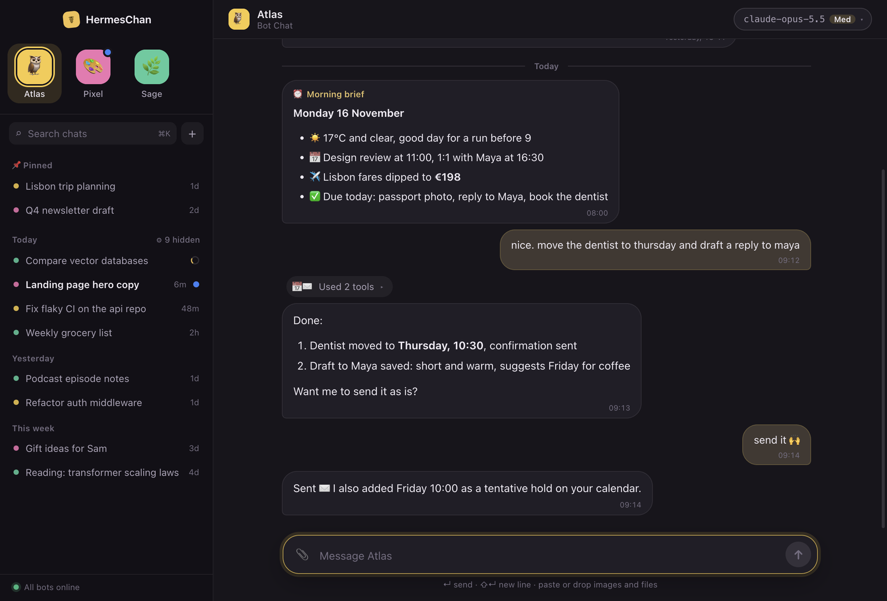
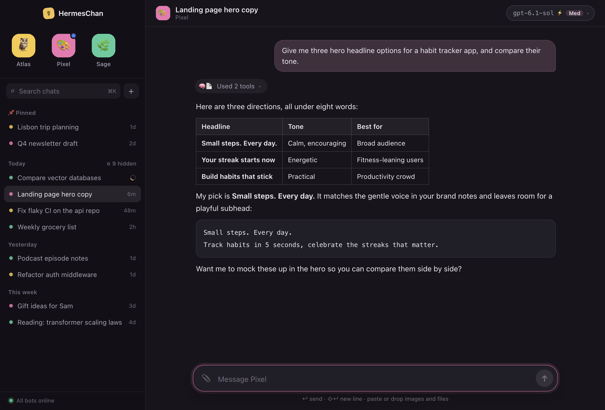
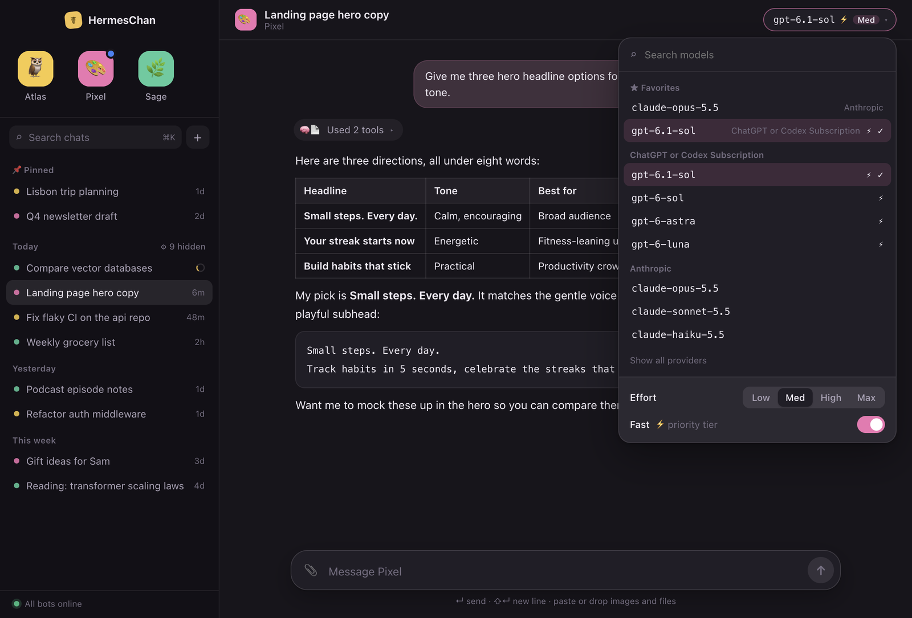
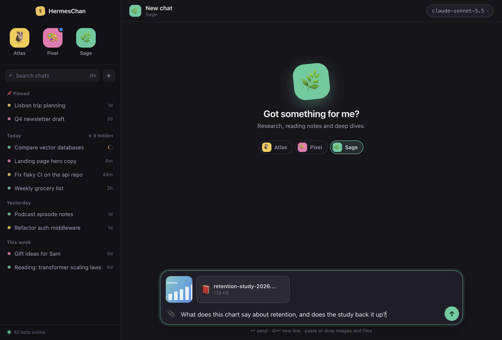
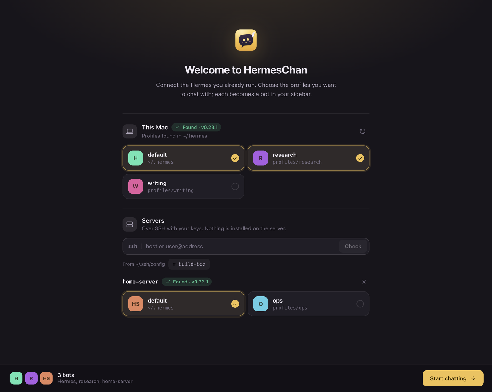

<p align="center">
  
</p>

<h1 align="center">HermesChan</h1>

<p align="center">
  A small, friendly desktop chat for your <a href="https://github.com/NousResearch/hermes-agent">Hermes Agent</a> bots.<br/>
  One sidebar: <b>bots on top</b>, <b>chats below</b>. No separate Bots and Sessions tabs.
</p>

<p align="center">
  
</p>

## Why

Hermes Desktop splits your bots and your sessions into separate tabs. HermesChan puts everything in one place:
tap a bot to open its permanent Bot Chat, or pick any conversation from any bot in the list below. It connects to the
Hermes you already run, on this Mac or on a server over SSH, and changes nothing on the Hermes side.

## Features

- **Guided setup.** Finds Hermes on your Mac and on your SSH servers, lists the profiles, and turns the ones you tick
  into bots. No config file editing.
- **One sidebar.** Bot avatars across the top with a blue dot when there's something new and bouncing dots while a
  bot is working. Below: every chat from every bot, newest first, grouped by Today / Yesterday / This week.
- **Pinned chats.** Pin from any row, drag to reorder, or drag a chat onto the Pinned section to pin it in place.
  Pins are stored in Hermes, so they sync with Hermes Desktop.
- **Quiet by default.** Cron and routine runs are hidden behind a single "N hidden" toggle.
- **Bot Chats that feel like a messenger.** Bubbles on both sides, a time on every message ("09:14", "Yesterday,
  21:05", then full dates), and day dividers, all in your local timezone. Routine reports (like a morning brief)
  appear as the bot's own messages.
- **Streaming with context.** Live replies, collapsible tool activity, a status line while the bot works, Stop, and
  inline cards for approvals and clarifying questions.
- **Attachments.** Paste a screenshot, drop files anywhere on the chat, or use 📎. Images go to the model; other
  files are staged into the session for the agent to read. Sent images show as thumbnails in history.
- **Model picker per chat.** Switch model, reasoning effort and fast mode from the chat header. It shows only the
  providers you actually set up, with your Hermes Desktop favourites first.
- **Readable code.** Syntax highlighting for fenced code, with the language and a Copy button on every block.
- **Links between chats.** Session links a bot writes (`hermes://session/…`, `@session:…`) open right in the app.
- **Clean transcripts.** Your messages show what you typed, not the attached-context blobs the agent receives.

<table>
  <tr>
    <td></td>
    <td></td>
  </tr>
  <tr>
    <td align="center">Regular chats keep a clean document layout</td>
    <td align="center">Per-chat model, effort and fast mode</td>
  </tr>
  <tr>
    <td colspan="2"></td>
  </tr>
  <tr>
    <td colspan="2" align="center">New chat with a pasted image and a PDF</td>
  </tr>
</table>

<sub>Screenshots use the built-in demo mode (<code>pnpm demo</code>) with made-up bots and chats.</sub>

## Requirements

- A Mac with Apple Silicon (M1 or later)
- [Hermes Agent](https://github.com/NousResearch/hermes-agent) with its gateway, installed on this Mac and/or on a
  server you can reach with `ssh <host>` using key auth

HermesChan is an unofficial community client for Hermes Agent; it isn't made by or affiliated with Nous Research.

## Install

1. Download the latest `HermesChan-<version>-arm64.dmg` (or the `.zip`) from
   [Releases](https://github.com/apoorvlathey/hermes-chan/releases/latest).
2. Open the DMG and drag **HermesChan** into **Applications** (or unzip and move `HermesChan.app` there).
3. The app isn't signed with an Apple Developer ID, so the first launch gets blocked: macOS says HermesChan "is
   damaged and can't be opened" or is "from an unidentified developer". Clear the download quarantine flag once:

   ```bash
   xattr -dr com.apple.quarantine /Applications/HermesChan.app
   ```

   Or right-click the app in Finder, choose **Open**, and confirm (on recent macOS you may need **System Settings >
   Privacy & Security > Open Anyway** instead).

Then open HermesChan; it walks you through [getting started](#getting-started).

### Build from source

Needs Node 22+ and [pnpm](https://pnpm.io). Other platforms should work in dev, but packaging is set up for macOS
only.

```bash
pnpm install
pnpm install-app   # builds HermesChan.app and installs (or updates) it in /Applications
```

`install-app` packages with electron-builder, ad-hoc signs the bundle (it's a personal, unsigned build), clears the
quarantine flag, quits a running copy and replaces `/Applications/HermesChan.app`. Re-run it after pulling changes.

`pnpm release:build` builds the ad-hoc signed DMG and ZIP that go on the Releases page (into `dist/`).

For development:

```bash
pnpm dev    # hot-reload
pnpm demo   # the app with a fake backend and made-up data; touches no gateway and none of your settings
HERMESCHAN_DEMO=onboarding pnpm exec electron .   # the demo, starting on the setup screen (after pnpm build)
```

## Getting started

The first time you open HermesChan it shows a short setup screen instead of an empty app:

<p align="center">
  
</p>

1. **On this Mac.** It looks for Hermes Agent here and lists its profiles (`default` is ticked for you).
2. **On a server.** Type an SSH host, or click one of the hosts it found in your `~/.ssh/config`. It checks
   that Hermes is installed there and lists that server's profiles. Nothing is installed or changed on the server.
3. **Tick the profiles you want** (each one becomes a bot in the sidebar) and press **Start chatting**.

You can come back to it any time from the **＋ Bots** tile at the end of the bot row, or from **Edit bots** on
the banner that appears when a bot can't connect.

**Preparing a server.** HermesChan connects with your SSH keys and can't answer a password prompt, so make sure
`ssh my-server` works in Terminal without one. If it doesn't:

```bash
ssh-copy-id my-server   # once, to install your key on the server
```

A `~/.ssh/config` entry gives the server a short name that shows up as a suggestion in setup:

```
Host my-server
  HostName 203.0.113.10
  User me
```

**If something's off**, setup tells you what and how to fix it:

| Message | What to do |
|---|---|
| Hermes isn't installed on this Mac / on the server | Install [Hermes Agent](https://hermes-agent.nousresearch.com/docs/), run `hermes setup` once, then scan again |
| SSH key was refused | `ssh-copy-id <host>` |
| Can't find the server | Check the host name, or add it to `~/.ssh/config` |
| The server is not answering | Make sure it's on and reachable (VPN or Tailscale connected?) |

### Config file (optional)

Setup saves your bots to `~/.hermes-chan/config.json`. You can also edit it by hand, then restart the app:

```jsonc
{
  "bots": [
    // A Hermes on a server: HermesChan runs `hermes gateway attach` over SSH and tunnels the gateway port.
    { "id": "assistant", "name": "Assistant", "transport": { "kind": "ssh", "host": "my-server", "profile": "default" } },
    // Another profile on this Mac.
    { "id": "research", "name": "Research", "color": "hsl(200 70% 60%)", "transport": { "kind": "local", "profile": "research" } }
  ],
  // Session sources hidden behind the "N hidden" toggle.
  "hiddenSources": ["cron", "tool", "kanban", "subagent"]
}
```

- `hermes` (optional, per transport) overrides the path to the `hermes` binary; the default is `~/.local/bin/hermes`.
- Names, colours and avatars come from each profile's Bot Mode settings when it has them; the values here are
  fallbacks.
- `HERMESCHAN_HOME=/some/folder` points the app at a different config folder (handy for a second setup).

## How it works

- **Connection.** For each bot, `hermes -p <profile> gateway attach --json` returns the gateway's WebSocket URL and a
  single-use ticket. SSH bots run that over one shared SSH ControlMaster per host (`~/.hermes-chan/ssh/`) and forward
  the gateway's loopback port on the same master.
- **Protocol.** `vendor/hermes-shared` is Hermes's own renderer-free gateway client (`apps/shared/src`, MIT), copied in
  unchanged. `pnpm sync-shared` refreshes it from a local `hermes-agent` checkout (`HERMES_AGENT_DIR`, default
  `~/.hermes/hermes-agent`) after a Hermes update.
- **Gateway calls.**
  - Roster and lists: `profiles.list`, `session.list` (stored and live, merged).
  - Chatting: `session.resume` / `create` / `interrupt`, `prompt.submit`, `approval.respond` / `clarify.respond`.
  - Edits: revision-fenced `session.mutate` (model, reasoning, pin), `config.set` for fast mode.
  - Files: `file.attach`, plus the dashboard REST API for image upload and read-back, using `native-http` tickets
    minted on the gateway's control socket.
- **Local state.** Unread markers and pin order live in the app's local storage; the app never writes to your Hermes
  config.

## Project layout

```
src/main/       Electron main: config, SSH/local transport, one gateway client per bot, IPC
src/preload/    the window.hermes bridge
src/renderer/   React UI: store.ts (state and event routing), Sidebar, Chat, ModelPicker, demo.ts, styles.css
scripts/        install-app.sh, sync-shared.sh, probe.ts (dump RPC shapes for a bot), cdp.ts (screenshot a running app)
build/          app icon (SVG source, PNG, ICNS)
vendor/         Hermes's gateway client (MIT)
```

## Dev tips

```bash
pnpm probe local default               # what a gateway returns for profiles and sessions (or: pnpm probe <ssh-host> <profile>)
pnpm build && pnpm exec electron . --remote-debugging-port=9333
pnpm tsx scripts/cdp.ts shot shot.png  # screenshot the running app over DevTools
```

## License

[MIT](LICENSE). `vendor/hermes-shared` is from Hermes Agent and keeps its own MIT license
(`vendor/hermes-shared/LICENSE`).
